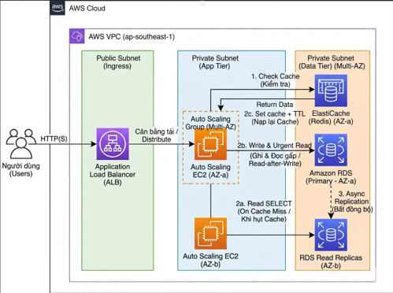

# Overview: Diagnosing the Database Bottleneck

When first learning Cloud architecture, it is easy to assume that placing an **Application Load Balancer** in front of an EC2 **Auto Scaling Group** is enough to handle any traffic spike.

I held that exact assumption until running a load test for my project. When simulated traffic jumped from a few hundred to 10,000 concurrent users:

- The Auto Scaling Group scaled out right on schedule: `2 EC2 → 4 EC2 → 8 EC2`
- Web server CPU utilization stayed comfortably around `40–50%`
- Yet in the browser, the homepage took `6–8 seconds` to load before timing out completely

Checking Amazon CloudWatch quickly revealed the real culprit: the **Amazon RDS** instance behind the web tier was pinned at **100% CPU**.

**Original Post:** [View on Facebook](https://www.facebook.com/share/p/19pPm2zNwx/)

---

## 1. How Auto Scaling EC2 Accidentally "Chokes" the Database

Real-world web applications (e-commerce, news portals, forums) typically exhibit heavily skewed traffic patterns: roughly **80–90%** of operations are **READS** (browsing product catalogs, reading articles, checking carts), while only **10–20%** are **WRITES**.

**What happens during a sudden traffic surge:**
- As the Auto Scaling Group launches more EC2 instances, the volume of `SELECT` queries hitting the single RDS instance scales proportionally
- Thousands of concurrent requests repeatedly fetch the exact same dataset (such as top 10 flash-sale items or leaderboards)
- The database continuously reads from EBS storage, burning through IOPS and CPU cycles on redundant queries and starving critical write transactions like order creation and checkout

In short: the *stateless* web tier scales horizontally with ease, leaving a single *stateful* database as the sole bottleneck of the entire architecture.

---

## 2. Two Defensive Layers to Optimize Read Workloads

### 2.1. First Line of Defense: Amazon ElastiCache (Redis) & Cache-Aside

Before scaling up RDS to an expensive instance class, the first question to ask is: **which data changes infrequently yet gets read the most?** Instead of forcing RDS to recompute the same query 10,000 times per minute, I deployed **Amazon ElastiCache for Redis** inside a Private Subnet directly in front of the database using the **Cache-Aside (Lazy Loading)** pattern:

- **Cache Hit:** When an EC2 instance needs the featured product list, the application checks Redis first. If present in RAM, Redis serves it immediately—typically with sub-millisecond latency—without RDS ever seeing the request.
- **Cache Miss:** If the key is absent from Redis (or its TTL has expired), EC2 queries RDS, returns the result to the user, and populates Redis with an appropriate TTL (e.g., 60 seconds or 5 minutes).
- **Cache Invalidation:** Whenever data is updated in the database (such as a product price change), the application deletes or updates the corresponding Redis key so subsequent reads load fresh data rather than waiting for TTL expiration.

In my lab benchmark, offloading roughly 80% of repetitive reads to Redis cut RDS CPU utilization nearly in half. Exact savings vary depending on query complexity and cache hit ratio, so always measure against your own workload.

### 2.2. Second Line of Defense: Amazon RDS Read Replicas

For complex read queries (search filters, aggregations, reporting) that cannot be easily cached in Redis, **Amazon RDS Read Replicas** allow you to provision one or more read-only copies of the Primary DB via *asynchronous replication*.

**Splitting database connections at the application layer:**
- **Primary Endpoint:** Handles all write operations (`INSERT`, `UPDATE`, `DELETE`) and reads requiring strict immediate consistency
- **Read Replica Endpoint:** Absorbs heavy analytical and general `SELECT` read traffic

**Important Note:** For standard RDS for MySQL/PostgreSQL, each Read Replica exposes its own individual endpoint rather than a built-in load-balanced "reader endpoint." When running multiple replicas, your application must distribute traffic across endpoints (or use Route 53 weighted records). A unified reader endpoint is natively provided only by **Amazon Aurora** (and RDS Multi-AZ DB clusters).

---

## 3. Four Real-World Pitfalls to Watch Out For

While building the lab and reviewing AWS operational guides, I found that adding caching and replicas comes with four common traps:

### 3.1. Confusing Multi-AZ Standby with a Read Replica
A common misconception is that enabling Multi-AZ gives you a second active node for read scaling. In a standard Multi-AZ DB instance deployment, the synchronous standby is strictly passive for **High Availability** failover and cannot serve read queries. To scale reads, you must explicitly create a **Read Replica**. *(Multi-AZ DB clusters do offer readable standbys, though that is a distinct deployment topology.)*

### 3.2. Replication Lag
Because Read Replicas replicate asynchronously, they trail slightly behind the Primary—ranging from tens of milliseconds to several seconds under peak write load. If a user submits an order (writing to Primary) and the confirmation page immediately runs a `SELECT` against a Read Replica, it might return "Order not found." Always route **read-after-write** flows directly to the Primary endpoint.

### 3.3. Cache Stampede on Simultaneous TTL Expiration
If thousands of cached keys expire at the exact same moment (e.g., midnight `00:00`), thousands of concurrent requests will experience simultaneous cache misses and hammer RDS at once. A practical fix is adding **TTL jitter** (e.g., `300s + random(0..30s)`) to stagger expirations. For ultra-hot keys (such as flash-sale items), combine jitter with mutex locking (allowing only one request to recompute the cache) or proactive background refresh.

### 3.4. Memory Eviction and `ap-southeast-1` Costs
Caching everything without TTLs or memory limits will fill Redis RAM and trigger key **eviction**, degrading your cache hit ratio. Cost-wise, in the Singapore region (`ap-southeast-1`), a small `cache.t4g.micro` node costs roughly `~$13/month` (730 hours)—very affordable for student labs. However, spinning up two or three large Read Replicas and forgetting to tear them down afterward will quickly inflate your monthly AWS bill.

---

## Conclusion

Upgrading from a basic Web Scale setup to a **Read-Optimized Architecture** highlights three essential design principles:

- **Never scale up the database before checking your Read/Write ratio:** Most database bottlenecks in standard web apps stem from repetitive read queries rather than write throughput limits
- **Follow a structured optimization hierarchy:** Absorb hot reads in memory (`ElastiCache Redis`) → offload complex reads to `RDS Read Replicas` → scale up the instance class only as a last resort
- **Clean up lab resources promptly:** Delete Read Replicas and ElastiCache clusters once benchmarking is done to protect your Free Tier or AWS credits *(and consider connection pooling or Amazon RDS Proxy if concurrent EC2 connections become a bottleneck)*

---

**References:**  
- Amazon RDS Read Replicas Overview: https://docs.aws.amazon.com/AmazonRDS/latest/UserGuide/USER_ReadRepl.html  
- Amazon ElastiCache Caching Strategies (Cache-Aside): https://docs.aws.amazon.com/AmazonElastiCache/latest/dg/Strategies.html  
- Amazon RDS Multi-AZ vs. Read Replicas: https://aws.amazon.com/rds/features/read-replicas/  
- Amazon ElastiCache Pricing (ap-southeast-1): https://aws.amazon.com/elasticache/pricing/  
- Best Practices for Amazon RDS: https://docs.aws.amazon.com/AmazonRDS/latest/UserGuide/CHAP_BestPractices.html

---
