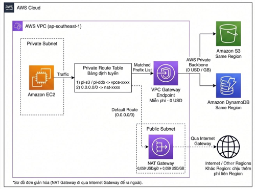

# Overview: Uncovering Hidden Private Subnet Data Transfer Charges

When learning AWS network design, the first security best practice we apply is isolating application servers (EC2, ECS) inside **Private Subnets** so they never expose Public IPs to the Internet, while placing a **NAT Gateway** in a Public Subnet so private instances can still download packages and call external APIs.

I built that exact textbook architecture for a data processing project:

- Backend workers on EC2 (Private Subnet) compressed logs, generated reports, and uploaded backups to **Amazon S3**, while reading/writing job states in **Amazon DynamoDB**—all within the Singapore region (`ap-southeast-1`)
- Everything ran smoothly and securely

However, checking **Billing & Cost Management** at the end of the month brought an unwelcome surprise: beyond the fixed hourly NAT Gateway charge, **NAT Gateway Data Processing** added tens of dollars—even though the application barely called any external third-party APIs. The reason lies in a subtle routing detail: **By default, Amazon S3 and DynamoDB reside outside your VPC and use Public IP ranges—meaning all traffic between EC2 and S3 was detouring through the NAT Gateway.**

**Original Post:** [View on Facebook](https://www.facebook.com/share/p/154F8Gp26wY/)

---

## 1. Why Does Internal AWS Traffic Get Billed Through a NAT Gateway?

When an EC2 instance inside a Private Subnet executes `aws s3 cp` or writes objects via an AWS SDK:

- The domain `s3.ap-southeast-1.amazonaws.com` resolves to a public AWS IP address
- EC2 evaluates the **Private Route Table** associated with its subnet. With no dedicated internal route for S3, packets match the catch-all default rule: `0.0.0.0/0 → nat-xxxx` (NAT Gateway)
- Hundreds of gigabytes of backups and datasets traverse the NAT Gateway (and Internet Gateway) just to reach S3 in the exact same region

**NAT Gateway pricing in Singapore (`ap-southeast-1`):**
- **Hourly Charge:** `$0.059/hour` (~`$43.07/month` for 730 hours, even with zero traffic)
- **Data Processing Charge:** `$0.059/GB` for all data passing through the gateway

Transferring just `500 GB/month` between EC2 and S3 (system logs, media uploads, database dumps) incurs an extra **$29.50/month** in NAT Gateway data processing fees—for traffic that never needed to leave AWS's regional network.

---

## 2. The Zero-Cost Solution: How VPC Gateway Endpoints Work

To keep S3 and DynamoDB traffic strictly within the **AWS Private Backbone** without traversing a NAT Gateway or Internet Gateway, AWS provides **VPC Gateway Endpoints**.

### 2.1. Longest Prefix Match Routing Mechanics

Gateway Endpoints rely on standard **Longest Prefix Match** route selection inside your Route Table:

- You provision a **VPC Gateway Endpoint** (`vpce-xxxx`) for Amazon S3 (or DynamoDB) and associate it with your Private Route Table
- AWS automatically injects a route using an **AWS Managed Prefix List** (`pl-s3-id`, representing all regional S3 IP ranges) pointing directly to `vpce-xxxx`
- Packets destined for S3/DynamoDB match `pl-s3-id → vpce-xxxx` (more specific than `0.0.0.0/0`) and travel privately over AWS's internal network at **$0/hour** and **$0/GB**, while OS updates (`apt update`) and third-party API calls continue routing via `0.0.0.0/0 → nat-xxxx`

### 2.2. Routing Architecture Overview

- **Upper Path (Matched Prefix List):** Same-region traffic from EC2 to S3 and DynamoDB is intercepted by the Private Route Table and routed via the VPC Gateway Endpoint (`$0/GB`)
- **Lower Path (Default Route `0.0.0.0/0`):** Only outbound Internet requests or cross-region S3/DynamoDB calls traverse the NAT Gateway in the Public Subnet (`$0.059/hour + $0.059/GB`). *(Note: Diagram simplified; the Internet Gateway sits between the NAT Gateway and the Internet.)*

---

## 3. Four Configuration Pitfalls to Avoid

### 3.1. Confusing Free Gateway Endpoints with Hourly Interface Endpoints
Only two AWS services support completely free Gateway Endpoints: **Amazon S3** and **Amazon DynamoDB**. Other services (SQS, SNS, Secrets Manager, ECR, CloudWatch, etc.) use **Interface Endpoints (AWS PrivateLink)**, which bill per AZ (~`$0.01/hour/AZ` plus per-GB data processing). Because S3 supports both types, accidentally selecting an Interface Endpoint will still incur hourly charges.

### 3.2. Forgetting to Associate the Private Route Table
If you create a Gateway Endpoint without selecting your Private Subnet's Route Table during setup, AWS will not inject the `pl-s3-id → vpce-xxxx` route—leaving your traffic silently flowing through the NAT Gateway.

### 3.3. Cross-Region Buckets Bypass Gateway Endpoints (and Trigger Double Charges)
VPC Gateway Endpoints are strictly regional (e.g., EC2 in `ap-southeast-1` accessing an S3 bucket in `ap-southeast-1`). If your bucket resides in `us-east-1`, its IP range falls outside Singapore's Prefix List, forcing traffic through the NAT Gateway (`$0.059/GB`) **plus** Inter-Region Data Transfer fees.

### 3.4. Locking Yourself Out of Console, CLI, and SDKs with `aws:SourceVpce`
A major security perk of Gateway Endpoints is adding a `Deny` rule to your S3 Bucket Policy blocking any request not originating from your `vpce-xxxx` (using `StringNotEquals` on `aws:SourceVpce`). However, without an exemption clause, this blocks all access outside the VPC—including your own AWS Management Console, CLI, and local SDK calls (`Access Denied`). Always add an exclusion condition (such as `ArnNotLike` on `aws:PrincipalArn`) for administrative IAM roles or users.

---

## 4. How to Verify in 30 Seconds

- **Inspect the Route Table:** Navigate to **VPC → Route Tables → select your Private Route Table → Routes tab**, and confirm a route with Destination `pl-xxxxxxxx` (`com.amazonaws.ap-southeast-1.s3`) pointing to Target `vpce-xxxxxxxx`
- **Check NAT Gateway CloudWatch Metrics:** Upload a `1–2 GB` test file from EC2 to S3. On CloudWatch, the NAT Gateway's `BytesOutToDestination` metric should remain flat at `0` instead of spiking

---

## Conclusion

Optimizing private subnet data transfers on AWS comes down to three key takeaways:

- **Eliminate unnecessary NAT detours:** Large S3 transfers from Private Subnets without a Gateway Endpoint incur avoidable per-GB NAT Gateway processing fees
- **Use free VPC Gateway Endpoints:** Enable Gateway Endpoints (`$0`) to keep same-region S3 and DynamoDB traffic on the AWS Private Backbone
- **Double-check associations and policies:** Always attach the Private Route Table, keep buckets in the same region, and include an `aws:PrincipalArn` exception when restricting bucket policies via `aws:SourceVpce`

---

**References:**  
- Gateway VPC Endpoints: https://docs.aws.amazon.com/vpc/latest/privatelink/vpce-gateway.html  
- Gateway Endpoints for Amazon S3: https://docs.aws.amazon.com/vpc/latest/privatelink/vpc-endpoints-s3.html  
- Amazon VPC & NAT Gateway Pricing: https://aws.amazon.com/vpc/pricing/  
- AWS PrivateLink Pricing: https://aws.amazon.com/privatelink/pricing/  
- AWS Managed Prefix Lists: https://docs.aws.amazon.com/vpc/latest/userguide/managed-prefix-lists.html

---

## Author

  
  

    <h3 style="margin-top: 0;">AWS First Cloud Journey Intern</h3>
    
Cloud engineering intern in the AWS First Cloud Journey (FCJ) program, passionate about distributed systems architecture, performance optimization, and sharing hands-on cloud implementation insights.

  

