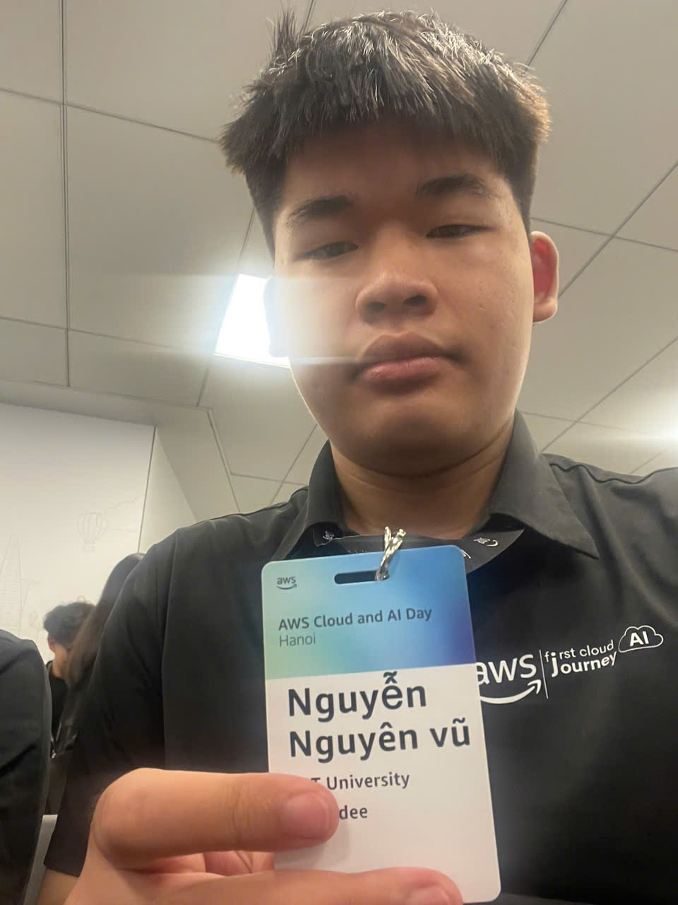

### Event Overview
- **Event Name:** AWS Cloud and AI Day Hanoi 2026 – Ho Chi Minh City Watch Party Hub
- **Date:** September 29, 2026
- **Attendance Format:** In-person attendance at the **Ho Chi Minh City Watch Party** (livestreaming Keynotes & Developer Chats from the Hanoi venue alongside the AWS First Cloud Journey community)
- **Organizers:** AWS Vietnam, AWS Community Builders & AWS First Cloud Journey (FCJ)
---

### Key Highlights Followed from the Event

#### 1. Shifting from "Technology Adoption" to "Operational Maturity"
- The focus of Vietnam's Cloud and AI ecosystem in 2026 has moved beyond Proof-of-Concept (PoC) experiments toward **Operational Maturity**—running production systems reliably and securely at scale.
- Production-grade workloads demand clear ownership, well-defined access boundaries, comprehensive observability, high resilience, and repeatable cost governance models.

#### 2. Agentic AI and the Foundational Role of Platform Engineering
- **Agentic AI** stood out as a central theme: AI agents are evolving from passive content generators into autonomous actors capable of invoking APIs, querying internal data, modifying code, and triggering deployment workflows.
- As development velocity and agent autonomy accelerate, **Platform Engineering** becomes essential for establishing strong engineering guardrails—standardizing deployment patterns, enforcing secure defaults, governing software supply chains, and setting approval boundaries for agent actions.

#### 3. Identity Governance for Workloads & AI Agents (Workload Identity on AWS)
- Followed the **Developer Chats** session by **Kha Van** (Cloud Security Engineer / AWS Community Builder) centered on a critical architectural question: *"When a workload calls an AWS API, what identity is actually making that request?"*
- In modern cloud architectures, **non-human identities**—such as Kubernetes Pods, CI/CD pipelines, serverless functions, and AI agents—far outnumber human user accounts.
- **Practical Solutions on AWS:** Adopting **Amazon EKS Pod Identity**, short-lived temporary credentials, fine-grained workload-level authorization instead of overly broad inherited EC2 node permissions, strict IAM trust policies, and runtime verification.

#### 4. AWS Infrastructure Expansion in Vietnam & Hybrid Architecture Decisions
- Highlighted the expansion of AWS local infrastructure in Vietnam with **AWS Direct Connect in Hanoi** and the **Hanoi AWS Local Zone**, giving organizations greater flexibility for private connectivity, low-latency workloads, and data locality compliance.
- This enables architects to make more nuanced trade-offs across latency, resilience, compliance, security, and cost between on-premises environments and the cloud.

#### 5. Real-World Transformation Stories & Vietnam’s Growing Builder Ecosystem
- **TCBS Customer Story:** Demonstrated that meaningful AI transformation happens when it reshapes how engineering teams write, review, test, and deliver software—backed by measurable operational outcomes rather than simply adding another tool to the stack.
- **Vietnam Cloud & AI Ecosystem Scale:** Keynote figures highlighted over **157,000** individuals trained in cloud and AI, more than **54,000** members in the **AWS Study Group**, and over **15,000** participants in the **First Cloud and AI Journey (FCJ)** ecosystem.

---

### Ho Chi Minh City Watch Party Experience & Key Takeaways
- **Community Connection at the HCMC Hub:** Although the main event took place in Hanoi, joining the Ho Chi Minh City Watch Party provided an energetic space to watch the sessions live with fellow FCJ interns and mentors, discuss real-world architectural trade-offs on the spot, and strengthen local community ties.
- **Three Core Lessons Applied to My Internship:**
  1. **Production-First Mindset:** Always design AWS projects with logging, observability, and cost controls from day one rather than stopping at a working demo.
  2. **Identity-Centric Security:** Avoid granting broad permissions to workloads or AI agents; prioritize temporary credentials and the principle of least privilege.
  3. **Leveraging Community Knowledge:** Actively learn from practitioners and AWS Community Builders, and document/share insights back with the community to solidify architectural understanding.

