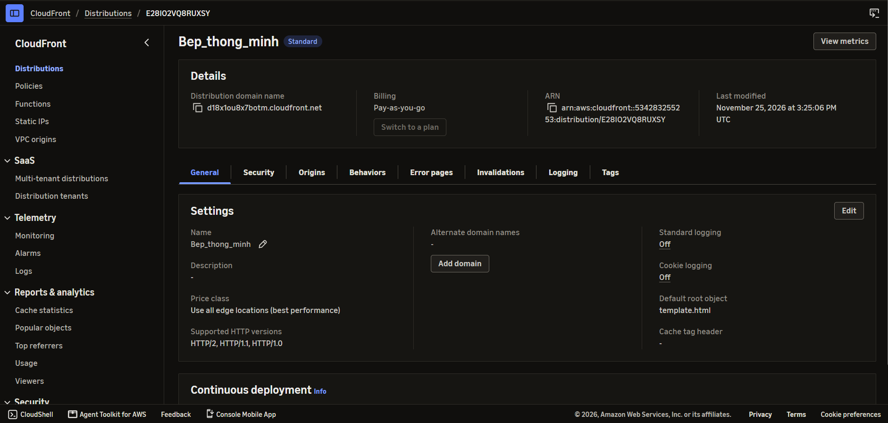

> **Lưu ý kỹ thuật:** Trình duyệt web hiện đại chặn API định vị GPS (`navigator.geolocation`) nếu trang web chạy trên giao thức `http://`. Do đó, việc triển khai **Amazon CloudFront** để cung cấp chứng chỉ **HTTPS** là bắt buộc.

#### 1. Cấu hình Amazon S3
  . Tạo S3 bucket tên `recipe-suggestion-website`, bỏ tích **Block all public access**.
  . Thêm **Bucket policy** cho phép đọc công khai:

```json
{
  "Version": "2012-10-17",
  "Statement": [
    {
      "Sid": "PublicReadGetObject",
      "Effect": "Allow",
      "Principal": "*",
      "Action": "s3:GetObject",
      "Resource": "arn:aws:s3:::recipe-suggestion-website/*"
    }
  ]
}
```
  .Bật Static website hosting với Index document là template.html, sau đó upload file template.html lên thư mục gốc của bucket.

#### 2. Cấu hình Amazon CloudFront
Truy cập CloudFront → Create distribution, chọn Origin domain trỏ tới bucket S3 của bạn (để trống ô Origin path).

  . Tại Viewer protocol policy, chọn Redirect HTTP to HTTPS.

  . Tại Web Application Firewall (WAF), chọn Do not enable security protections để tối ưu chi phí.

  . Tại Settings, nhập Default root object là template.html và bấm Create distribution.

  . Khi trạng thái chuyển sang Deployed, truy cập ứng dụng qua tên miền https://<id>.cloudfront.net.



