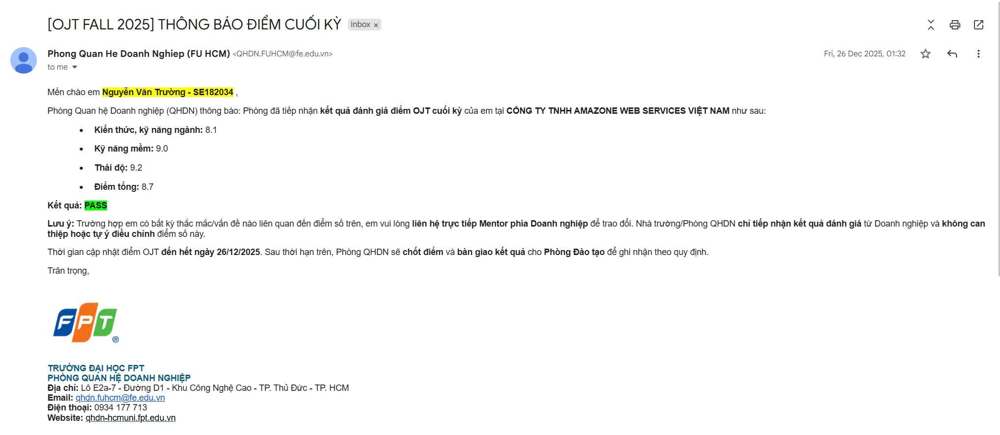

During my On-the-Job Training (OJT) internship at **Amazon Web Services Vietnam Co., Ltd.** from **September 2026** to **December 2026** under the **AWS First Cloud Journey (FCJ)** program, I had the opportunity to immerse myself in a dynamic, disciplined, and cloud-first engineering environment. Moving beyond university coursework, this internship helped me build practical cloud architecture skills, adopt a production-oriented mindset, and develop stronger professional work habits.

Throughout the program, I contributed to the **[Your Project Name]** project, where I worked on designing, deploying, and optimizing cloud-based workflows on AWS. Alongside project development, translating technical articles, preparing hands-on workshop guides, and participating in AWS community sessions deepened my understanding of real-world system reliability, security best practices, and cost optimization.

Across all assigned tasks, I maintained a proactive learning attitude, followed team workflows and reporting schedules consistently, and collaborated closely with mentors and fellow interns to deliver quality outcomes on time.

### Self-Evaluation Summary

| No. | Evaluation Criteria | Assessment Scope | Good | Fair | Average |
| --- | --- | --- | :---: | :---: | :---: |
| 1 | **Technical Knowledge & Cloud Skills** | Applying AWS services, architectural patterns, and tooling effectively in practical tasks | ☐ | ✅ | ☐ |
| 2 | **Learning Agility** | Speed of researching new cloud technologies and adapting to unfamiliar requirements | ✅ | ☐ | ☐ |
| 3 | **Initiative & Proactiveness** | Actively proposing ideas, testing solutions, and contributing beyond minimum expectations | ✅ | ☐ | ☐ |
| 4 | **Work Ownership & Responsibility** | Accountability for task quality, documentation accuracy, and meeting weekly milestones | ✅ | ☐ | ☐ |
| 5 | **Workplace Discipline** | Adhering to schedules, office etiquette, security guidelines, and reporting processes | ✅ | ☐ | ☐ |
| 6 | **Receptiveness to Feedback** | Listening to mentor reviews and iterating on architectures or reports constructively | ✅ | ☐ | ☐ |
| 7 | **Technical Communication** | Articulating ideas clearly in discussions, technical blogs, and structured documentation | ☐ | ✅ | ☐ |
| 8 | **Team Collaboration** | Coordinating smoothly, sharing knowledge, and supporting teammates during sprints | ✅ | ☐ | ☐ |
| 9 | **Professional Conduct** | Demonstrating integrity, respect, and a positive attitude in all interactions | ✅ | ☐ | ☐ |
| 10 | **Analytical & Troubleshooting Skills** | Diagnosing root causes of configuration or deployment issues systematically | ☐ | ✅ | ☐ |
| 11 | **Overall Project Contribution** | Practical impact and consistency of deliverables across the internship lifecycle | ☐ | ✅ | ☐ |
| 12 | **Overall Self-Rating** | Holistic reflection on personal and professional growth during the OJT term | ☐ | ✅ | ☐ |

### Key Strengths & Areas for Further Growth

- **Key Strengths:**
  - Rapidly picking up core and emerging AWS services through hands-on experimentation and documentation.
  - Maintaining structured weekly progress tracking, technical writing, and consistent attendance at FCJ community events.
- **Areas for Further Growth:**
  - Deepening production-scale troubleshooting, security hardening, and cost-modeling skills for complex multi-service architectures.
  - Strengthening real-time technical presentation and English communication confidence during architectural reviews and Q&A sessions.
  - Refining time estimation when balancing research exploration with strict implementation deadlines.

---

## Official OJT Evaluation Results

*(To be updated upon receiving the official Fall 2026 OJT evaluation report from the **FPT University Corporate Relations Department (QHDN)** and **Amazon Web Services Vietnam Co., Ltd.**)*

| Evaluation Category | Score |
| --- | :---: |
| **Professional Knowledge & Skills** | `[Pending]` |
| **Soft Skills** | `[Pending]` |
| **Attitude & Discipline** | `[Pending]` |
| **Overall Score** | **`[Pending]`** |

### Final Result: ⏳ **IN PROGRESS / PENDING**

I am sincerely grateful to the mentors and engineers at **AWS Vietnam** for their dedicated technical guidance, as well as **FPT University** for facilitating this valuable industry experience.

<!-- Uncomment the line below once you upload your official Fall 2026 score screenshot to static/images/6-Self-evaluation/ -->
<!--  -->
