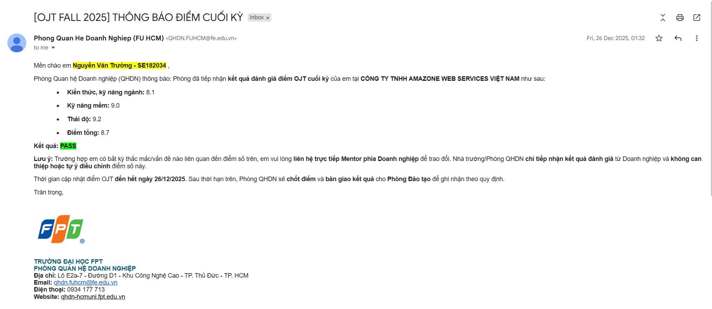

Trong suốt kỳ thực tập (OJT) tại **Amazon Web Services Việt Nam** từ **tháng 09/2026** đến **tháng 12/2026** trong khuôn khổ chương trình **AWS First Cloud Journey (FCJ)**, tôi đã có cơ hội được rèn luyện trong một môi trường kỹ thuật chuyên nghiệp, kỷ luật và lấy công nghệ đám mây làm trọng tâm. Vượt ra ngoài những kiến thức nền tảng trên giảng đường, kỳ thực tập này đã giúp tôi xây dựng kỹ năng thiết kế kiến trúc Cloud thực tiễn, hình thành tư duy hướng tới môi trường vận hành thực tế (*production-oriented*) và rèn luyện tác phong làm việc chuyên nghiệp hơn.

Trong chương trình, tôi đã tham gia đóng góp vào dự án **Bếp thông minh**, đảm nhận các công việc liên quan đến thiết kế, triển khai và tối ưu hóa các luồng xử lý trên nền tảng AWS. Song song với việc phát triển dự án, quá trình dịch thuật các bài viết kỹ thuật, biên soạn tài liệu hướng dẫn thực hành (workshop) và tham gia các buổi chia sẻ cộng đồng của AWS đã giúp tôi hiểu sâu hơn về độ tin cậy của hệ thống thực tế, các nguyên tắc bảo mật tốt nhất và bài toán tối ưu chi phí.

Đối với mọi nhiệm vụ được giao, tôi luôn duy trì tinh thần chủ động học hỏi, tuân thủ nghiêm túc quy trình làm việc cũng như lịch báo cáo tiến độ của nhóm, đồng thời phối hợp chặt chẽ với các anh/chị mentor và các bạn thực tập sinh khác để hoàn thành công việc đúng thời hạn với chất lượng tốt nhất.

### Điểm mạnh nổi bật & Định hướng cải thiện

- **Điểm mạnh nổi bật:**
  - Tiếp thu nhanh các dịch vụ cốt lõi cũng như công nghệ mới trên AWS thông qua việc trực tiếp thực hành và hệ thống hóa tài liệu.
  - Duy trì đều đặn việc theo dõi tiến độ hàng tuần, viết blog kỹ thuật và tích cực tham gia các sự kiện cộng đồng của FCJ.
  - Phối hợp hiệu quả với các thành viên trong nhóm và chủ động tiếp thu góp ý từ mentor để cải thiện sản phẩm qua từng giai đoạn.
- **Định hướng cải thiện trong thời gian tới:**
  - Nâng cao hơn nữa kỹ năng xử lý sự cố (*troubleshooting*) ở quy mô production, tăng cường bảo mật (*security hardening*) và ước tính mô hình chi phí cho các kiến trúc đa dịch vụ phức tạp.
  - Rèn luyện sự tự tin khi thuyết trình kỹ thuật trực tiếp và giao tiếp tiếng Anh trong các buổi review kiến trúc cũng như phiên hỏi đáp (Q&A).
  - Cải thiện khả năng ước lượng thời gian nhằm cân đối hiệu quả giữa việc nghiên cứu công nghệ mới và đảm bảo tiến độ triển khai thực tế.

---

## Kết quả đánh giá OJT chính thức

*(Sẽ được cập nhật sau khi nhận bảng đánh giá tổng kết kỳ thực tập Fall 2026 chính thức từ **Phòng Quan hệ Doanh nghiệp (QHDN) – Đại học FPT** và **Công ty TNHH Amazon Web Services Việt Nam**)*

| Tiêu chí đánh giá | Điểm số |
| --- | :---: |
| **Kiến thức & Kỹ năng chuyên môn** | `[Đang cập nhật]` |
| **Kỹ năng mềm** | `[Đang cập nhật]` |
| **Thái độ & Kỷ luật** | `[Đang cập nhật]` |
| **Điểm tổng kết** | **`[Đang cập nhật]`** |

### Kết quả cuối cùng: ⏳ **ĐANG THỰC HIỆN / CHỜ CẬP NHẬT**

Tôi xin gửi lời cảm ơn chân thành đến các anh/chị mentor và đội ngũ kỹ sư tại **AWS Việt Nam** vì sự hướng dẫn tận tình về mặt chuyên môn, cũng như **Đại học FPT** đã tạo điều kiện để tôi có được trải nghiệm thực tế quý giá này.

<!-- Bỏ dấu chú thích ở dòng dưới sau khi bạn tải ảnh chụp thông báo điểm chính thức kỳ Fall 2026 lên thư mục static/images/6-Self-evaluation/ -->
<!--  -->
